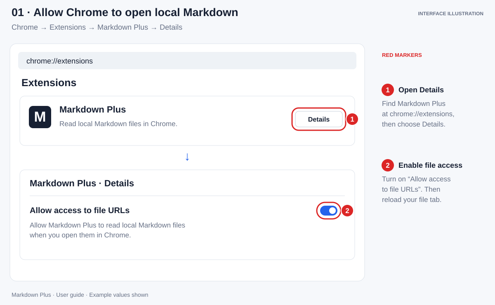
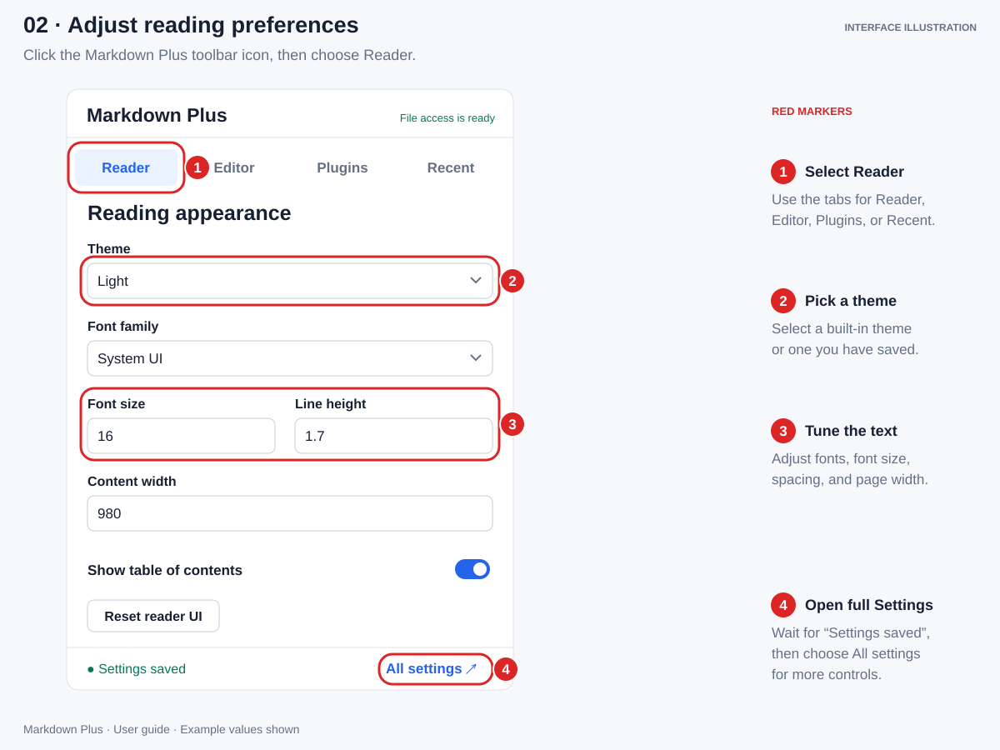
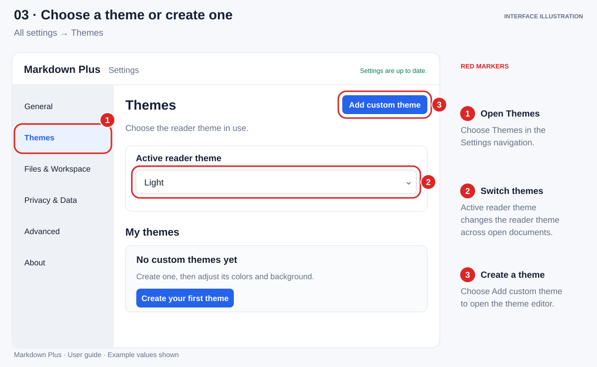
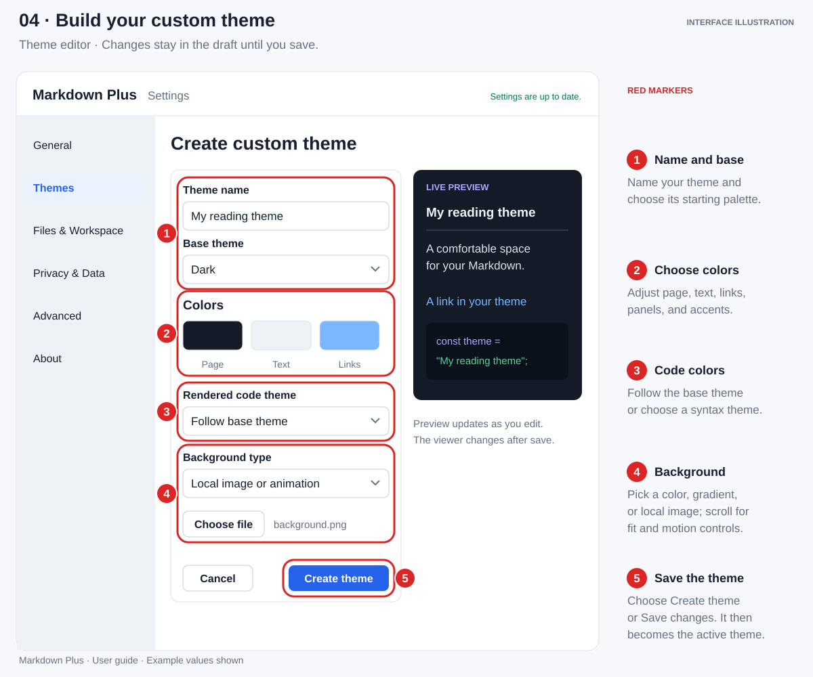
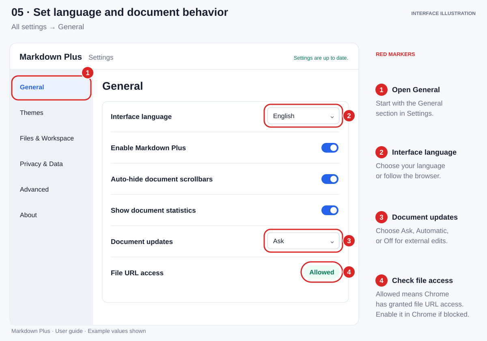
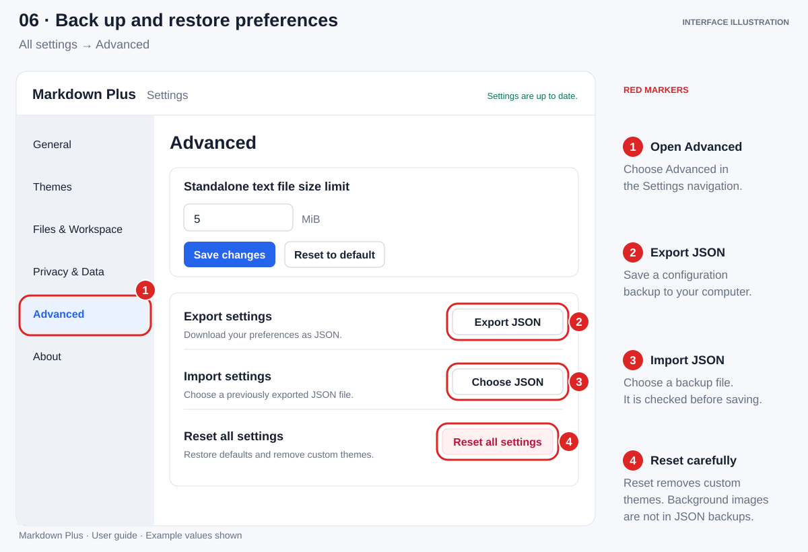

  

<h1 align="center">Markdown Plus</h1>

<strong>A comfortable home for your local Markdown.</strong>

Read, browse, and personalize your documents right in Chrome.

  

  <strong><a href="https://chromewebstore.google.com/detail/markdown-plus/afbdmkpldpbkmmhejjlajocpneaiipmk">Add to Chrome</a></strong> · <a href="#quick-start">Quick start</a> · <a href="https://thaibalong7.github.io/markdown-viewer-chrome-extension/">Website</a> · <a href="https://github.com/thaibalong7/markdown-viewer-chrome-extension/issues">Help &amp; feedback</a> · <a href="https://thaibalong7.github.io/markdown-viewer-chrome-extension/privacy/">Privacy policy</a> · <a href="CHANGELOG.md">Release notes</a> · <a href="#contributing">Contribute</a> · <a href="#contributors">Contributors</a>

---

Markdown Plus turns local Markdown files into formatted documents with a file browser, heading outline, diagrams, and customizable reading themes. Use it for project documentation, personal notes, study material, or a whole folder of Markdown files.

**Your documents are processed locally in your browser.** No account or document upload is required.

## On this page

- [Features](#features)
- [Quick start](#quick-start)
- [Release notes](#release-notes)
- [Reader controls](#reader-controls)
- [Themes and backgrounds](#themes-and-backgrounds)
- [Settings](#settings)
- [Working with documents](#working-with-documents)
- [FAQ](#faq)
- [Privacy and support](#privacy-and-support)
- [Contributing](#contributing)
- [Contributors](#contributors)

## Features

| Feature | What you can do |
| :--- | :--- |
| 📖 **Read rich Markdown** | View highlighted code, tables, task lists, math, footnotes, emoji, and GitHub-style alerts. |
| 🗂️ **Browse and navigate** | Open a folder as a workspace, jump between headings with Outline, and reopen recent Markdown files. |
| 🔍 **Find text** — unreleased | Find in the open document or search file contents across the current folder/workspace, including the active unsaved draft. |
| 🎨 **Make it yours** | Choose light, dark, or high-contrast themes; adjust typography; create your own colors and backgrounds. |
| 🔎 **Explore diagrams and images** | View Mermaid diagrams, pan and zoom, and download diagrams as SVG or PNG. |
| 🔄 **Follow file changes** | Detect external edits, choose when to load them, and review source differences. |
| ✏️ **Edit with live preview** | Opt in to the experimental Markdown editor and save back to a verified local file. |
| 📤 **Print and share** | Print, save a PDF through Chrome, or export Markdown as HTML or Word (`.doc`). |

## Quick start

Requires **Google Chrome 116 or newer**.

1. Open [Markdown Plus on Chrome Web Store](https://chromewebstore.google.com/detail/markdown-plus/afbdmkpldpbkmmhejjlajocpneaiipmk) and choose **Add to Chrome**. Confirm **Add extension** when Chrome asks.
2. Open `chrome://extensions`, find **Markdown Plus**, and choose **Details**. Turn on **Allow access to file URLs**.
3. Open a local `.md`, `.markdown`, `.mdown`, or `.mdc` file in Chrome. Drag it into a tab, or use <kbd>Ctrl</kbd> + <kbd>O</kbd> on Windows/Linux or <kbd>⌘</kbd> + <kbd>O</kbd> on macOS.
4. Click the Markdown Plus toolbar icon to choose a theme and adjust reading preferences. Pin the icon from Chrome's Extensions menu for easier access.

> [!IMPORTANT]
> **File URL access is required.** If the file still opens as plain text, enable that permission, check **All settings → General → Enable Markdown Plus**, and reload the file tab.

*Red markers: **1** open extension details; **2** allow file URL access. The illustrations in this guide show simplified interfaces and example values.*

**Choose your language:** open **All settings → General → Interface language** for English, Vietnamese, Simplified Chinese, or your browser's language. Document content stays in its original language. This guide uses English control names.

## Release notes

**1.0.0.1 — Change review scrolling fix.** Keeps the comparison dialog in view and long affected-section lists contained. Packaged November 3, 2026; Chrome Web Store publication has not been verified for this version.

See [release notes and known limitations](CHANGELOG.md) or the [website release notes](https://thaibalong7.github.io/markdown-viewer-chrome-extension/releases/).

The Find and workspace-search workflow below describes the current development source. It has not yet been assigned a release version or verified in the Chrome Web Store package.

## Reader controls

Click the extension icon to open the popup. Changes save automatically; wait for **Settings saved** before closing it. Preferences apply across your documents.

*Red markers: **1** choose Reader; **2** pick a theme; **3** tune the text; **4** open All settings.*

| Popup tab | Controls |
| :--- | :--- |
| **Reader** | Theme, font family, font size (**12–28 px**), line height (**1.2–2.2**), content width (**640–1400 px**), and Outline visibility. **Reset reader UI** restores the default theme selection, typography, and layout. |
| **Editor** | Enable experimental editing; set editor font size (**12–24 px**) and tab size (**2–8 spaces**); toggle word wrap and line numbers; reset editor preferences. |
| **Plugins** | Toggle Markdown features and choose the Mermaid renderer. All plugins are enabled by default. |
| **Recent** | Reopen recent local Markdown files or clear the list. File URL access is required for reopening. |

Font presets use fonts installed on your system, with fallbacks when a named font is unavailable. Choose **All settings** for the full Settings page, or **About** for version and support information.

<strong>Which Markdown features can I toggle?</strong>

The Plugins tab includes **Code highlight**, **Task list**, **Anchor heading**, **Table enhance**, **Emoji**, **Footnotes**, **GitHub Alerts**, **Color preview**, **Math (KaTeX)**, and **Mermaid diagrams**.

Color preview shows swatches and lets you copy HEX, RGB, or HSL values. Task-list checkboxes are read-only in the reader; edit the Markdown source to change them. If formatting is missing, check its plugin toggle here.

For Mermaid, choose **Official** for the broadest syntax support, or try **Beautiful** for an alternative diagram layout.

## Themes and backgrounds

Choose a theme in **Popup → Reader → Theme** or **All settings → Themes → Active reader theme**. The selection is shared between both places and updates open viewers. Fonts, spacing, and page width remain separate Reader preferences.

Built-in themes include **Light**, **Dark**, **High Contrast Light**, **High Contrast Dark**, **Sakura**, **Matcha**, **Solarized Dark**, **Dark (VS Code)**, **Dracula**, **Gruvbox**, **Night Owl**, **Min (Dark)**, and **Aurora Glass**, which includes an animated gradient.

*Red markers: **1** open Themes; **2** switch the active theme; **3** start a custom theme.*

<strong>Create a custom theme — illustrated steps</strong>

Open **All settings → Themes → Add custom theme**, then follow the five markers:

1. Name the theme and choose a **Base theme** as the starting palette.
2. Adjust colors for the page, document, panels, headings, links, code, and accents.
3. Under **Code highlighting**, follow the base theme or choose a bundled syntax theme for rendered code blocks.
4. Choose a background and check the live preview. Scroll for image fit, position, motion, and dimming controls.
5. Select **Create theme** or **Save changes**. The saved theme becomes active and appears under **My themes** in the popup.

Changes stay in the draft until you save. Changing the base theme resets the draft's color palette. Use **Edit**, **Use theme**, or **Delete** in the library to manage saved themes.

### Background options

| Background | Customize it |
| :--- | :--- |
| **Theme color only** | Use the theme's normal page background. |
| **Solid scene** | Choose one background color. |
| **Gradient** | Choose two colors and the gradient angle. |
| **Local image or animation** | Choose PNG, JPEG, WebP, AVIF, GIF, or APNG up to **5 MiB**; set fit, position, and repeat. |

For scene backgrounds, use **Dimming** to improve readability and choose **Follow system**, **Animate**, or **Still** for motion. Follow system respects reduced-motion preferences. Still hides animated image backgrounds rather than freezing them on a frame.

> [!NOTE]
> Background images stay on the device where you added them. They are not synchronized or included in settings JSON backups. Choose the image again on another device.

## Settings

Open the popup and choose **All settings**. The Settings page groups the remaining controls by purpose:

| Section | What you can change |
| :--- | :--- |
| **General** | Interface language, extension activation, auto-hiding scrollbars, document statistics, document updates, and file URL access status. |
| **Themes** | Active theme and custom-theme creation, editing, selection, and deletion. |
| **Files & Workspace** | File-tree hierarchy lines, `.gitignore` exclusions, restoring the last file-backed workspace, and scan limits for depth, files, and folders. Depth **0** scans only the selected root. |
| **Privacy & Data** | Enable or disable recent-file history, set how many entries to retain, and clear the list. Clearing history does not delete your files. |
| **Advanced** | Viewing size limit for standalone `.txt`, `.sql`, `.dbml`, and `.mermaid` files; JSON settings backup/restore; and resets. The viewing limit does not apply to Markdown. |
| **About** | Installed version, browser compatibility information, website, support, privacy policy, source code, and license. |

*Red markers: **1** open General; **2** choose the language; **3** set document updates; **4** check file access. Chrome's extension details control the permission itself.*

**Saving:** switches and selections generally save immediately. Numeric limits use **Save changes**; theme drafts use **Create theme** or **Save changes**. Check the status message to confirm success. File-tree guides update immediately; scan policies and limits apply on the next scan or refresh, and the text viewing limit applies on the next document open.

<strong>Back up, restore, or reset settings</strong>

In **Advanced**, choose **Export JSON** to download your configuration. To restore it, use **Choose JSON** under Import settings. The file is validated before saving. Backups contain preferences and custom-theme definitions; documents, recent-file history, and background images are excluded.

*Red markers: **1** open Advanced; **2** export a backup; **3** import a backup; **4** reset all settings.*

**Reset all settings** removes custom themes and their stored backgrounds along with restoring preferences. Export your configuration first if you want to keep it, and retain the original background image files separately. Section reset controls restore that section's defaults. Recent-file history is cleared separately in Privacy & Data or the popup's Recent tab.

## Working with documents

### Files, folders, and Outline

The **Files** panel lists supported files alongside the open document. Choose **Open folder…** to browse a workspace, grant access when Chrome asks, and select a file from the tree. Click a heading in **Outline** to jump to that section. Hide or resize either panel to give the document more room.

| Format | Open it |
| :--- | :--- |
| `.md`, `.markdown`, `.mdown`, `.mdc` | Directly in Chrome, or through Files. |
| `.txt`, `.sql`, `.dbml`, `.mermaid` | Through Files, after opening a Markdown document. |
| `.png`, `.jpg`, `.jpeg`, `.gif`, `.webp`, `.avif`, `.bmp`, `.ico`, `.apng`, `.svg` | Through Files, after opening a Markdown document. |

Use **Refresh file list** after adding, removing, or renaming files. It rescans the list without reloading the current document. If files are missing, check `.gitignore` and scan limits in Files & Workspace, then refresh.

Markdown statistics show word count, character count including spaces, and estimated reading time; hide them in General settings. Use Back to top on long documents. On smaller windows, look in the document actions' overflow menu for additional commands.

### Find in a document or across files

Press **Cmd/Ctrl+F**, or choose **Find in document** in the document actions, to find text in the reading surface. A focused editor keeps its own Find/Replace. For Chrome's page-wide Find, including visible sidebar text, use the browser menu; virtualized rows outside the DOM are not searchable there.

Choose the magnifier in **Files**, or press **Ctrl+Shift+F** on every platform, to search the current folder/workspace. On macOS, use **Control**, not Command. Only the tree area changes; the Files header stays in place. No second folder selection is needed when Files already has a searchable scope. Search covers supported text formats and the active unsaved draft, respecting the current file-list exclusions and scan limits.

| Control | Behavior |
| :--- | :--- |
| **Aa — Match case** | Distinguish uppercase and lowercase. Off by default. |
| **ab — Match whole word** | Match a complete word. Off by default. |
| **Á — Match diacritics** | Distinguish accents. On by default; turn it off so `hai` can match `hải` and `duong` can match `đường`. |

Typing searches after a short pause: **100 ms** in the reader and **250 ms** across files. Enter in the workspace query or **Search again** runs immediately and bypasses the content cache. While results update, the previous rows stay visible but cannot be opened. Matching is literal; regular expressions are not supported.

Results are grouped by file with line numbers and short, single-line excerpts. Select a result to open and highlight its location while retaining keyboard focus in the result list. Use **↑/↓** to move between rows, **Enter** to open a row, and **F4/Shift+F4** to open the next/previous visible result. A match in hidden Markdown syntax opens a read-only source view when it cannot be mapped reliably to rendered text. Yellow identifies matches; orange identifies the current match.

Search reuses bounded, in-memory content and Unicode caches; workspace matching runs in a local Worker. **Search again** rereads the current file list, while **Refresh file list** discovers added, removed or renamed files. A workspace opened through the snapshot-only folder picker must be selected again to obtain newer file contents. Search does not continuously monitor every file or persist a content index. Files over **2 MiB**, searches reaching **2,000 matches**, and work exceeding a **15-second** processing budget produce partial-result notices. See [search behavior and limits](docs/search.md).

### Diagrams, images, and export

Mermaid code blocks render as diagrams when the plugin is enabled. Standalone `.mermaid` files also offer diagram/source switching. Open an image or diagram in the larger viewer to fit, zoom, and pan. Mermaid diagrams support source copying and **SVG** or **PNG** export at **1×–4×** PNG scales.

Choose **Print / Save as PDF** and select a printer or **Save as PDF** in Chrome's print dialog. Markdown also offers **Export document → HTML** or **Word (.doc)**. Exit edit mode to print or export documents.

### External edits and change review

Choose how to handle changes from another app in **All settings → General → Document updates**:

| Mode | Behavior |
| :--- | :--- |
| **Ask** — default | Checks for changes and waits for you to load the update. |
| **Automatic** | Loads a stable update after you stop interacting, while trying to preserve reading position. |
| **Off** | Stops automatic checks; **Check now** remains available. |

Use **Document updates** in the viewer to check or load a revision. **View changes** shows added/removed source lines; Markdown comparisons also identify affected sections. Images support updates without a source comparison.

An open comparison stays on the selected revision until **Review latest** is chosen. Automatic mode can still update the document behind it; choose Ask to control when revisions load. Live updates check the active document while the tab is visible and support files up to **5 MiB**. If a folder was opened as a snapshot and live updates are unavailable, select it again.

<strong>Edit Markdown with live preview — experimental</strong>

Editing is off by default:

1. Turn on **Popup → Editor → Enable editor**.
2. Open a Markdown document and choose **Edit Markdown** in the viewer.
3. Select and verify the **exact original file**, checking its folder and filename. Chrome requires this connection before the extension can write to it.
4. Edit beside the live preview, or use focus mode to hide it. Search and replace is available in the editor.
5. Choose **Save**, or press <kbd>Ctrl</kbd> + <kbd>S</kbd> / <kbd>⌘</kbd> + <kbd>S</kbd>, to write to the connected original file.

The editor warns before discarding unsaved work and refuses to overwrite a file changed externally after editing began. Document updates never automatically replace an active editor. Loading an external revision requires confirmation and closes edit mode.

## FAQ

<strong>Why does my Markdown file still open as plain text?</strong>

Enable **Allow access to file URLs** in Chrome's extension details, enable Markdown Plus in General settings, and reload the tab. Direct opening supports `.md`, `.markdown`, `.mdown`, and `.mdc`.

<strong>Can I use Markdown Plus on a website or open an image directly?</strong>

Markdown Plus activates on local Markdown files. Download the Markdown document and open it in Chrome. For text, SQL, DBML, Mermaid, or images, open a Markdown file first, then choose the other file in Files.

<strong>Why are files or recent changes missing?</strong>

For missing files, check `.gitignore` exclusions and scan limits in Files & Workspace, then refresh the file list. For edits to the open document, use **Document updates → Check now** and load the update in Ask mode. If the folder was opened as a snapshot, select it again. If a recent file moved, reopen it from its new location.

<strong>Why is my background missing on another device?</strong>

Background images stay on the original device. Edit the custom theme on the new device and choose the image again.

<strong>Why does a setting fail to save?</strong>

Check the popup or Settings save status for an error. If Chrome reports a storage limit, reduce custom-theme data or remove unused themes, then retry.

## Privacy and support

Markdown Plus processes documents locally and does not send their contents to a developer-operated service. Recent file paths, editor file connections, and custom background images stay on your device. Preferences may synchronize through Chrome. Remote resources referenced by documents can still contact their hosts; see the [Privacy Policy](https://thaibalong7.github.io/markdown-viewer-chrome-extension/privacy/).

- **Explore:** visit the [Markdown Plus website](https://thaibalong7.github.io/markdown-viewer-chrome-extension/).
- **Get help or suggest a feature:** [open an issue](https://github.com/thaibalong7/markdown-viewer-chrome-extension/issues). Include Chrome and extension versions, steps to reproduce, and an example with private content removed.

## Contributing

You can help improve Markdown Plus through bug reports, ideas, documentation, translations, testing, or code. You do not need to be a developer to contribute.

| How to help | Where to start |
| :--- | :--- |
| 🐛 **Report a bug** | [Check existing issues](https://github.com/thaibalong7/markdown-viewer-chrome-extension/issues), then [open an issue](https://github.com/thaibalong7/markdown-viewer-chrome-extension/issues/new) with your Chrome and extension versions, steps to reproduce, and expected versus actual behavior. A small example file or screenshot helps; remove private content first. |
| 💡 **Suggest an improvement** | Describe the problem you want to solve and how the change would help. Discuss larger features in an issue before starting implementation. |
| 🌍 **Improve docs or translations** | Point out an unclear instruction, missing step, or awkward translation. Include the page or control, interface language, and suggested wording, or submit a correction as a pull request. |
| 🧪 **Test a fix** | Try the steps in an existing issue or pull request and share your Chrome version, operating system, and results. |

### Submit a pull request

1. Check [open issues](https://github.com/thaibalong7/markdown-viewer-chrome-extension/issues) and [pull requests](https://github.com/thaibalong7/markdown-viewer-chrome-extension/pulls) for related work.
2. Fork the repository and make a focused change on a new branch. Small documentation fixes are welcome too.
3. Verify the affected behavior. For extension changes, try the relevant flow in Chrome; for documentation, check the wording, links, and illustrations.
4. Open a pull request describing the problem, your change, related issues, and checks performed. Include screenshots or a short recording for visible interface changes.

For development setup, technical details, and project structure, see [DEV.md](DEV.md).

## Contributors

Created and maintained by [@thaibalong7](https://github.com/thaibalong7). Thank you to everyone who helps improve Markdown Plus through code, documentation, translations, testing, and useful bug reports.

See the repository's [contributors](https://github.com/thaibalong7/markdown-viewer-chrome-extension/graphs/contributors) and [merged pull requests](https://github.com/thaibalong7/markdown-viewer-chrome-extension/pulls?q=is%3Apr%20is%3Amerged) for contribution history.

---

Free and open source · <a href="LICENSE">MIT License</a>

