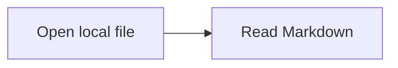

# Hướng dẫn đưa Markdown Plus 1.0.0 lên Chrome Web Store

Hướng dẫn chuẩn bị ngày **2026-10-30**, dựa trên tài liệu Chrome chính thức. Tên field có thể thay đổi theo giao diện/ngôn ngữ dashboard. Version public đã chốt là **1.0.0**; chỉ submit sau khi người dùng xác nhận QA chính ZIP trong [hồ sơ candidate](./release-candidate-1.0.0.md). Upload ZIP và lưu draft có thể làm trước khi QA hoàn tất.

Các tên tiếng Anh được giữ nguyên, kèm chú thích tiếng Việt trong ngoặc để đối chiếu với tài khoản Google đang dùng tiếng Việt. Đây là chú thích nhận diện thao tác; nhãn thực tế có thể khác đôi chút giữa các phiên bản dashboard. Ngôn ngữ giao diện Google không bắt buộc ngôn ngữ listing: ở bước Store listing vẫn chọn English (Tiếng Anh) cho bản mô tả mặc định hiện có.

## 1. Đăng ký và thiết lập tài khoản developer

1. Mở [Chrome Web Store Developer Dashboard](https://chrome.google.com/webstore/devconsole) (Trang tổng quan dành cho nhà phát triển Cửa hàng Chrome trực tuyến) và đăng nhập Google account sẽ sở hữu extension lâu dài.
2. Nếu dashboard hiện màn hình đăng ký, đọc/chấp nhận Developer Agreement (Thỏa thuận dành cho nhà phát triển) và policies (chính sách), rồi tự hoàn tất phí đăng ký một lần theo số tiền hiển thị. Nếu đã vào được danh sách Items (Mục) thì bỏ qua bước đăng ký.
3. Bật [2-Step Verification](https://myaccount.google.com/signinoptions/two-step-verification) (Xác minh 2 bước) cho Google account này. Đây là yêu cầu trước khi publish hoặc update extension.
4. Trong dashboard, mở **Account** (Tài khoản), nhập **Publisher name** (Tên nhà xuất bản) muốn hiển thị ở “Offered by” (Do … cung cấp). Không cần verified publisher badge để phát hành lần đầu.
5. Nhập contact email (email liên hệ) bạn theo dõi thường xuyên, bấm **Verify email** (Xác minh email), mở email xác minh và hoàn tất cho đến khi dashboard báo đã verify.
6. Điền các thông tin tài khoản/xác minh khác nếu dashboard yêu cầu. Khai đúng tư cách cá nhân/tổ chức và trạng thái trader (thương nhân) nếu form xuất hiện; không tự chọn dựa riêng vào việc extension miễn phí.
7. Bật email notifications (thông báo qua email) cho item được duyệt/publish để nhận kết quả. Hoàn tất khi vào được Items (Mục) và không còn account requirement đang chặn submit.

Nguồn: [Register](https://developer.chrome.com/docs/webstore/register/), [Account setup](https://developer.chrome.com/docs/webstore/set-up-account), [2-Step Verification policy](https://developer.chrome.com/docs/webstore/program-policies/two-step-verification).

## 2. Tạo item và upload ZIP

1. Mở **Items → Add new item** (Mục → Thêm mục mới). Nếu đã tạo draft cho Markdown Plus, mở lại draft đó để tránh tạo listing trùng.
2. Chọn **Choose file** (Chọn tệp), chọn đúng ZIP ghi trong [hồ sơ candidate](./release-candidate-1.0.0.md), rồi **Upload** (Tải lên). Không upload thư mục `extension/`, `dist.zip` cũ hay bộ source của repo.
3. Trong **Package** (Gói), xác nhận tên Markdown Plus, numeric version **1.0.0**, Manifest V3 và minimum Chrome **116**. Display version có timestamp là dấu nhận diện candidate do release script tạo; numeric version vẫn là `1.0.0`.
4. Lưu extension/item ID và URL dashboard vào hồ sơ candidate. Nếu validation báo lỗi, xử lý lỗi rồi upload lại trước khi đi tiếp.

## 3. Điền Store listing

1. Mở **Store listing** (Trang thông tin trên Cửa hàng / Danh sách cửa hàng), chọn ngôn ngữ mặc định **English** (Tiếng Anh).
2. **Detailed description** (Nội dung mô tả chi tiết; live form hiện ghi **Mô tả**): copy phần Detailed description trong [store-listing.md](./store-listing.md), bắt đầu từ “Markdown Plus turns local Markdown files…” đến hết “…for storage details and controls.”, bao gồm one-time local file setup và bốn bước setup ở giữa. Dừng trước heading **Reviewer instructions**. Không copy phần ghi chú nội bộ Screenshot scope hay tiêu đề tài liệu. Khi paste vào field text, dùng văn bản thuần và URL đầy đủ thay cú pháp Markdown link.
3. **Category** (Danh mục; live form hiện ghi **Loại**): chọn **Tools** (Công cụ) trong nhóm **Productivity** (Năng suất). Trong dropdown người dùng đã cung cấp, NĂNG SUẤT là tiêu đề nhóm; Công cụ là lựa chọn cụ thể phù hợp với document workspace. Tên và short description (nội dung mô tả ngắn) được lấy từ manifest/localized metadata; kiểm tra chúng khớp sản phẩm.
4. **Store icon** (Biểu tượng cửa hàng): upload `assets/chrome-web-store/icon-128.png`.
5. **Screenshots** (Ảnh chụp màn hình): upload lần lượt `01-open-local-markdown.png`, `02-themes-for-focus.png`, `03-rich-markdown.png`, `04-preview-zoom-export.png`, `05-make-it-yours.png` từ `assets/chrome-web-store/` vào **Global screenshots** (Ảnh chụp màn hình hiển thị ở mọi ngôn ngữ). Cả năm ảnh đã được chuyển sang PNG RGB 24-bit không alpha, vẫn 1280 × 800 và giữ nguyên từng pixel RGB; so sánh với candidate trong QA trước submit. **Localized screenshots** (Ảnh chụp màn hình đã bản địa hóa) dùng cho bộ ảnh riêng của ngôn ngữ listing đang chọn, không phải ngôn ngữ tài khoản Google. Nếu dùng bộ ảnh chung, để vùng localized trống; không upload lặp lại cùng bộ vào cả hai vùng. Sau **Save draft** (Lưu bản nháp), xem **Why can't I submit?** (Tại sao tôi không thể gửi?) để kiểm tra lỗi thực tế, thay vì suy ra cả hai bộ đều bắt buộc chỉ từ dấu `*`. Lần đọc live dashboard ngày 2026-10-30 với vùng localized English trống, danh sách lỗi của bản nháp đã lưu không báo thiếu localized screenshots; đây chưa phải xác nhận toàn bộ listing/submission đã hoàn tất.
6. Nếu muốn dùng promo assets đã có: upload `small-promo-tile.png` vào small promo tile (hình ảnh quảng cáo nhỏ) và `marquee.png` vào marquee (hình ảnh quảng cáo lớn). Video có thể để trống. Các mục promo này là tùy chọn theo tài liệu Chrome.
7. Điền **Homepage/Website URL** (URL trang chủ / trang web): `https://thaibalong7.github.io/markdown-viewer-chrome-extension/` và **Support URL** (URL hỗ trợ): `https://github.com/thaibalong7/markdown-viewer-chrome-extension/issues`. Official URL (URL chính thức)/verified publisher (nhà xuất bản đã xác minh) có thể để trống nếu chưa verify domain.
8. Nếu bổ sung listing VI/中文, dùng menu ngôn ngữ và nhập nội dung tương đương; không coi việc có UI locale là bằng chứng detailed description của locale đã được nhập.
9. Bấm **Save draft** (Lưu bản nháp) hoặc nút lưu tương ứng, kiểm tra không còn lỗi bắt buộc trong tab này.

Đối chiếu tên file/kích thước trong [approved assets](../../assets/chrome-web-store/README.md). Nguồn: [Complete listing information](https://developer.chrome.com/docs/webstore/cws-dashboard-listing).

## 4. Điền Privacy practices

1. Mở **Privacy practices** (Phương pháp về quyền riêng tư) hoặc **Privacy** (Quyền riêng tư).
2. **Single purpose description** (Nội dung mô tả mục đích duy nhất): paste `A private local Markdown workspace for reading, navigating, editing, and exporting documents in Chrome.`
3. **Permission justifications** (Lý do về quyền): copy từng dòng tương ứng từ [privacy-disclosure.md → Permission justifications](./privacy-disclosure.md#permission-justifications): `storage`, `offscreen`, `downloads` và host `file:///*` nếu form hiện host permission. `downloads` chỉ phục vụ exports; Save editor dùng file handle.
4. **Remote code** (Mã từ xa): chọn **No, I am not using remote code** (Không, tôi không sử dụng mã từ xa) cho runtime đã đóng gói hiện tại. Không có JavaScript extension tải từ server; ảnh trong document và CSS trong file export đã được giải thích riêng trong policy.
5. **Data usage** (Sử dụng dữ liệu): đọc tooltip/định nghĩa của từng checkbox trong form. Đối chiếu inventory trong [privacy-disclosure.md](./privacy-disclosure.md#data-use-declaration). Document text/images/hyperlinks cần đối chiếu **Website content** (Nội dung trang web); file URLs và recent-file navigation cần đối chiếu **Web history** (Lịch sử duyệt web). Chọn những category thực sự khớp định nghĩa form hiện tại và ghi lại lựa chọn; xử lý local không phải lý do để bỏ disclosure. Không tick tất cả loại dữ liệu nhạy cảm chỉ vì một document tùy ý có thể chứa chúng.
6. Kiểm tra các certification về không bán/chuyển dữ liệu ngoài mục đích đã công bố, không dùng cho creditworthiness/lending và Limited Use; chỉ xác nhận sau khi đọc và đối chiếu runtime/policy. Preferences có thể đi qua Chrome Sync, còn image binaries/file handles/history ở local; không mô tả mọi dữ liệu là device-only.
7. **Privacy policy URL** (URL chính sách quyền riêng tư): paste `https://thaibalong7.github.io/markdown-viewer-chrome-extension/privacy/`.
8. Lưu draft. Ghi các category đã chọn, permission text, policy URL và kết quả lưu vào [privacy-permissions-verification.md](./privacy-permissions-verification.md). Cần xem live form để chốt category cuối; hướng dẫn này không chứng nhận dashboard đã hoàn tất.

Nguồn: [Privacy fields](https://developer.chrome.com/docs/webstore/cws-dashboard-privacy), [User Data FAQ](https://developer.chrome.com/docs/webstore/program-policies/user-data-faq).

## 5. Distribution và Test instructions

1. Mở **Distribution** (Phân phối). Để phát hành công khai, chọn **Public** (Công khai). Chọn các quốc gia/khu vực bạn muốn phục vụ và xác nhận lựa chọn free (miễn phí) nếu form hỏi; đây là lựa chọn của chủ sở hữu trước publish.
2. Mở **Test instructions** (Hướng dẫn kiểm tra). Ghi không cần tài khoản/mật khẩu để sử dụng extension.
3. Paste phần **Reviewer instructions** trong [store-listing.md](./store-listing.md#reviewer-instructions). Điều chỉnh câu mở đầu cho reviewer kiểm tra bản cài từ Store, thay vì yêu cầu họ Load unpacked: dùng `After installing Markdown Plus, open its Details page and enable Allow access to file URLs before opening a local Markdown file.` Giữ các bước kiểm tra blocked → allowed → blocked (bị chặn → được phép → bị chặn). Trên Chrome tiếng Việt, Details là **Chi tiết**; Allow access to file URLs là tùy chọn **Cho phép truy cập vào URL của tệp** hoặc cách diễn đạt tương đương. Câu tiếng Anh để paste cho reviewer vẫn giữ nguyên.
4. Bổ sung fixture tự tạo dễ làm theo: tạo file `review.md` có nội dung bên dưới, kéo file vào Chrome, kiểm tra heading/TOC, code highlighting, Math/Mermaid và Popup/Settings. Editor là experimental và cần bật trong Settings, chọn file gốc rồi cấp quyền ghi. Không yêu cầu reviewer đăng nhập Google để thử đọc/render; Sync là bước QA riêng.
5. Lưu mọi tab. Kiểm tra trạng thái các mục bắt buộc; lỗi thiếu thông tin thường có liên kết về đúng field cần sửa.

````markdown
# Markdown Plus review

## Features

- Local Markdown rendering
- Outline and syntax highlighting

```js
console.log('Markdown Plus 1.0.0')
```

Inline math: $E = mc^2$


````

## 6. Submit và publish sau khi QA được xác nhận

1. Chờ người dùng xác nhận manual QA trên đúng ZIP/SHA-256; xem [release-checklist.md → Manual release QA matrix](./release-checklist.md#manual-release-qa-matrix). Build/test pass không thay thế xác nhận này. Nếu cần sửa runtime, tạo và QA lại candidate mới, rồi cập nhật package draft.
2. Đối chiếu một lần cuối **Package version 1.0.0** (Phiên bản gói 1.0.0), ZIP/SHA-256, policy public, description/screenshots, category, contact, distribution và reviewer steps. Chốt disclosure selections trong live form.
3. Bấm **Submit for Review** (Gửi để xem xét). Nếu nút bị disable hoặc có thông báo lỗi, mở từng lỗi và hoàn tất field/account requirement được chỉ ra.
4. Trong hộp xác nhận, đề xuất bỏ chọn publish tự động sau duyệt (tùy chọn có nghĩa là “Tự động xuất bản sau khi được phê duyệt”) để bạn chủ động ngày launch. Nếu muốn tự động lên Store ngay khi duyệt thì giữ chọn; đây là quyết định của bạn khi submit.
5. Xác nhận submission. Lưu item ID, version, thời điểm submit và trạng thái review; theo dõi dashboard/email. Không có thời gian duyệt cố định được bảo đảm.
6. Nếu bị reject (từ chối), đọc lý do, sửa đúng vấn đề và submit lại. Nếu bản sửa thay package đã publish, numeric version phải tăng; không dùng timestamp để thay version bump.
7. Khi approved (đã được phê duyệt) và dùng deferred publishing (trì hoãn xuất bản), mở item rồi bấm **Publish** (Xuất bản) theo dashboard. Chrome cho tối đa **30 ngày** để publish bản đã duyệt trước khi phải submit lại; kiểm tra ngày hết hạn trong dashboard.
8. Khi Store hiển thị public listing, cài từ Store trên profile sạch, bật file URL access và thử mở Markdown/Popup/Settings. Ghi ngày publish và public Store URL vào hồ sơ release.

Nguồn: [Publish in the Chrome Web Store](https://developer.chrome.com/docs/webstore/publish).

## Đối chiếu nhãn tiếng Việt

Chú thích về Account, Publisher name và Verify email được đối chiếu với [tài liệu thiết lập tài khoản tiếng Việt của Google](https://developer.chrome.com/docs/webstore/set-up-account?hl=vi); Items/Add new item, Choose file/Upload, Package, Distribution và Submit for Review/Publish với [tài liệu xuất bản tiếng Việt](https://developer.chrome.com/docs/webstore/publish?hl=vi); các trường privacy với [tài liệu quyền riêng tư tiếng Việt](https://developer.chrome.com/docs/webstore/cws-dashboard-privacy?hl=vi). Các chú thích còn lại giải thích nghĩa thao tác để nhận diện field, chưa phải xác nhận từng nhãn trên dashboard của tài khoản đang đăng nhập.
