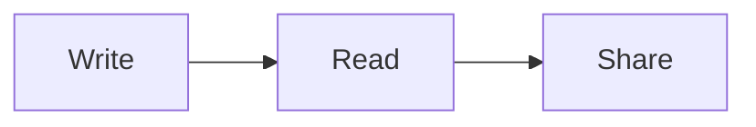

# A small Markdown Plus tour

Save this file on your computer, then open it in Chrome with Markdown Plus enabled. Use Outline to jump between the sections below. This English example has no remote images or resources.

## Your first checklist

- [x] Open a local Markdown file
- [ ] Pick a reader theme
- [ ] Open a folder from Files
- [ ] Try Print / Save as PDF

Task checkboxes in the reader are read-only. Change the Markdown source to update them.

## A useful table

| I want to… | Where to look |
| --- | --- |
| Change the font | Popup → Reader |
| Browse a project | Files → Open folder… |
| Check an external edit | Document updates → Check now |
| Customize a theme | All settings → Themes |

## Some code

```javascript
const notes = ['Read', 'Explore', 'Make it yours'];
notes.forEach((note) => console.log(note));
```

Try the code block’s copy control. You can toggle syntax highlighting in Popup → Plugins.

## A helpful note

> [!TIP]
> A little more line height can make a long document easier to read.

A footnote keeps a small reference nearby.[^local]

[^local]: Markdown Plus processes document content in your browser.

## A formula and a color

Inline math: $E = mc^2$.

$$
\sum_{k=1}^{n} k = \frac{n(n+1)}{2}
$$

Try opening the swatch for #2563eb and copying another color format.

## A diagram



Open the diagram in the larger viewer, zoom in, then try SVG or PNG export.

## Try an external change

Keep this file open in Chrome. Edit this paragraph in another text editor and save. In Markdown Plus, choose Document updates → Check now, then review or load the change. The default Ask mode waits for you to apply it.

## Keep exploring

Choose a different theme, adjust the font size, or print this document. Experimental editing must be enabled in Popup → Editor before Edit Markdown becomes available; saving requires selecting and verifying this exact original file.
